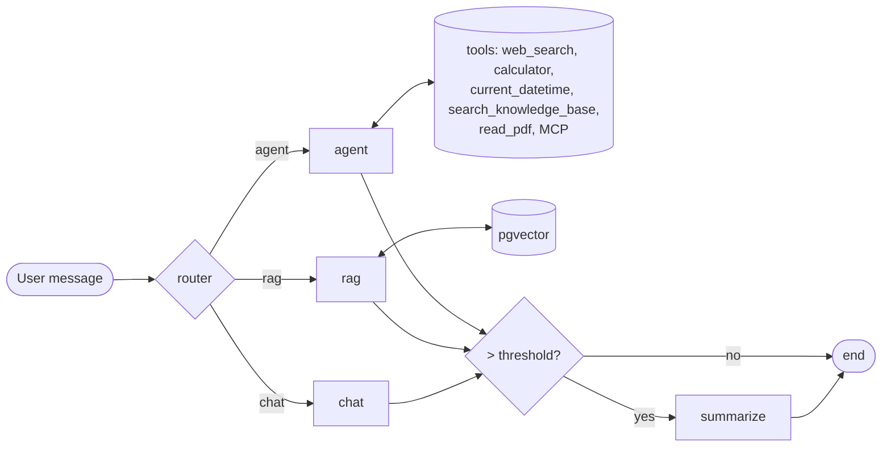
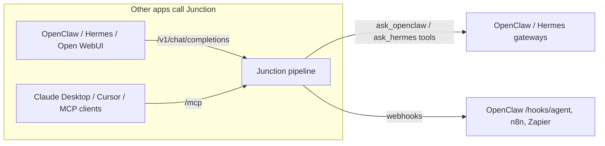

# Architecture

## Graph

- **router** asks the router model (structured output, `Router` schema) for `chat | rag | agent`. The prompt is built per request with today's date, the names of documents in the library and the available tools. `rag` is never chosen when the library is empty. If the model can't produce a structured decision, a keyword heuristic decides.
- **chat** answers with the recent conversation and running summary.
- **rag** runs MMR search (optionally cross-encoder rerank), numbers the passages and asks for inline citations. It emits a retrieval step and a `sources` event.
- **agent** is a ReAct loop. Each model turn streams; if the turn ends in tool calls, the node emits `draft_reset` (that text was planning, not the answer), records a *thinking* step, runs the tools in parallel with a timeout, and emits a step per call (`running`, then `done` or `error`). Web and library tools return structured artifacts, which become sources. After `max_iterations`, it is told to answer with what it has.
- **summarize** folds the messages it removes into the running summary, and keeps a window that starts on a user message.

Every node calls the model with a single system message, and the conversation window always starts with a user turn. Anthropic rejects conversations that open with an assistant turn, which plain `messages[-n:]` slicing produced on every other request.

## Request lifecycle

1. `POST /api/chat/stream` validates the body, creates the conversation if needed, stores the user message and returns a `StreamingResponse`.
2. `ChatTurn.events()` runs `ChatbotPipeline.stream()` in a task and forwards events through a queue, sending a heartbeat comment every 15 s so proxies don't drop the connection.
3. For a new conversation, a title is generated in parallel from the first message.
4. When the graph finishes, the assistant message is stored with metadata (route, steps, sources, elapsed time, model, request ID) and a `done` event is sent.
5. If the client disconnects (Stop button), the graph task is cancelled and whatever was written so far is saved with `stopped: true`, in a detached task outside the request's cancel scope.

## Streaming protocol

`text/event-stream`, one JSON object per `data:` line:

| `type` | Payload | Meaning |
|---|---|---|
| `meta` | `conversation_id, message_id, user_message_id, is_new` | First event |
| `route` | `route, label, reason` | Router decision |
| `step` | `step: {id, kind, title, detail, status, tool?, result?}` | Timeline stop. Upsert by `id` (tools go `running` to `done`) |
| `token` | `text` | Answer text as it's generated |
| `draft_reset` | | Discard streamed text; it was agent planning |
| `sources` | `items: [{kind: web\|doc, title, url?, page?, snippet}]` | Sources so far (replace) |
| `title` | `conversation_id, title` | Generated title for a new conversation |
| `done` | `message` | The stored assistant message (authoritative final text) |
| `error` | `code, message, request_id` | User-safe error; details are in the server log under `request_id` |

## Persistence

There are three stores, each with its own job:

| Store | Holds | Backend |
|---|---|---|
| LangGraph checkpointer | What the model remembers: messages after trimming, running summary, route | `AsyncPostgresSaver` with `DB_URI`, else in-memory |
| Chat store | What the user sees: full transcript, titles, per-answer metadata, document registry | `chatbot_*` tables with `DB_URI`, else in-memory |
| Vector store | Document chunks with IDs `<doc_id>:<n>` so single documents can be deleted | PGVector with `VECTOR_DB_URI`/`DB_URI`, else in-memory |

Table names are prefixed `chatbot_`, so they can't collide with the `chat_history` table from v1. In v1, two modules created that table with different schemas.

### Regenerate

`regenerate_checkpoint()` walks the thread's state history to the checkpoint where the latest user message entered (`metadata.source == "input"`). Streaming from that checkpoint with no new input re-runs the graph on a new branch. The thread's head moves to the new branch, so the question isn't duplicated in memory and the old answer drops out. The chat store deletes the previous assistant message.

## Security

- Optional bearer/`X-API-Key` auth on all `/api` routes (`API_KEYS`), constant-time comparison. Probes (`/health`, `/ready`) stay open.
- Sliding-window rate limit per key or IP on chat and upload endpoints. It's in-process, so add a shared limiter at the proxy for strict global limits.
- Upload names are sanitised (no path traversal), types are allow-listed, size is enforced while streaming to disk, and temp files are always removed.
- `read_pdf` only reads inside `workspace/`. The calculator evaluates an AST allow-list, never `eval`.
- Errors return a stable code, a user-safe message and the request ID. Internal messages (SQL, provider errors, stack traces) only go to logs.
- Security headers on every response. The CORS allow-list comes from `ALLOWED_ORIGINS`.
- The Docker image runs as a non-root user under `tini`.

## Integrations

`src/agentic_chatbot/integrations/`, configured by `config/integrations.yaml`. Everything is off by default. See [docs/integrations.md](docs/integrations.md).

- `agent_bridge.py` turns each enabled agent into a LangChain tool. The tool reads the current `thread_id` from the injected `RunnableConfig` and sends it as the OpenAI `user`, so the external agent keeps a session per conversation.
- `openai_compat.py` maps Junction events to OpenAI chunks. Research answers are held until final because `draft_reset` can't be expressed in the OpenAI stream format.
- `mcp_server.py` builds a stateless FastMCP server. Its route is added to FastAPI behind a bearer-key wrapper, and its session manager runs inside the app lifespan.
- `webhooks.py` delivers events from background tasks, drained on shutdown.
- `prepare_turn()` and `ChatTurn` are shared by the web UI, the OpenAI-compatible API and MCP, so every entry point gets the same persistence, titles, events and errors.

## Frontend

React 19, Vite, Tailwind 4, Motion.

- `lib/chat-store.tsx` holds app state and the streaming reducer. Tokens are batched per animation frame.
- `lib/api.ts` is a typed client with an SSE parser over `fetch`, since `EventSource` can't POST. Aborting the fetch is how Stop works.
- `hooks/parallax.tsx` turns pointer position and message-list scroll into springs. `Backdrop` uses three depth layers (station dots that wrap, transit lines, glows). In `RouteMap`, node positions are motion values and the branch paths are derived from them, so the graph bends with the pointer.
- Reduced motion disables pointer parallax, the draw-in and the signals. Touch devices get scroll parallax only.
