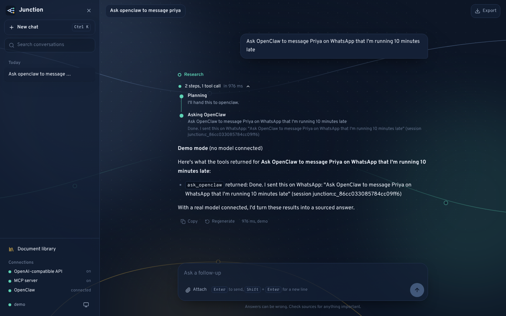

# Integrations (optional)

Junction works on its own. These integrations connect it to other agent systems, such as [OpenClaw](https://docs.openclaw.ai), [Hermes Agent](https://hermes-agent.nousresearch.com), MCP clients and automation tools. All of them are **off by default** and configured in `config/integrations.yaml`, switched on with environment variables in `.env`.

| Integration | Direction | Use it to |
|---|---|---|
| [External agents](#1-delegate-to-openclaw-hermes-or-any-agent) | Junction calls them | Let the Research route hand tasks to OpenClaw/Hermes ("message Priya I'm late") |
| [OpenAI-compatible API](#2-use-junction-as-the-model-in-other-apps) | Others call Junction | Use Junction (routing, your documents, research) as the model in OpenClaw, Hermes, Open WebUI, LibreChat or any OpenAI SDK |
| [Webhooks](#3-webhooks) | Junction notifies others | Tell OpenClaw, n8n or Zapier when an answer finishes or a document is added |
| [MCP server](#4-mcp-server) | Others call Junction | Give Claude Desktop, Cursor, Hermes and other MCP clients Junction's `ask` and document tools |

The sidebar's **Connections** section and `GET /api/integrations` (add `?refresh=true` to re-check agents) show what's on and whether it's reachable. If `integrations.yaml` has a mistake, the app still starts, every integration stays off, and the error appears in the sidebar.

---

## 1. Delegate to OpenClaw, Hermes or any agent

Each enabled agent becomes a tool named `ask_<name>` for the Research route. When you ask for something that agent does, the router picks Research, and the agent calls the tool with a self-contained instruction. The reply then shows up in the timeline as **Asking OpenClaw**. With `session: per_conversation`, Junction sends `user: "junction:<conversation id>"`, so OpenClaw keeps one session per Junction conversation.



### OpenClaw

1. Turn on OpenClaw's OpenAI-compatible endpoint (it's off by default) in your OpenClaw config:

   ```json5
   {
     gateway: {
       http: {
         endpoints: {
           chatCompletions: { enabled: true },
         },
       },
     },
   }
   ```

2. Add to Junction's `.env`:

   ```bash
   OPENCLAW_ENABLED=true
   OPENCLAW_URL=http://127.0.0.1:18789          # Docker on Windows/macOS: http://host.docker.internal:18789
   OPENCLAW_GATEWAY_TOKEN=<gateway.auth.token>   # or the OPENCLAW_GATEWAY_TOKEN OpenClaw uses
   # OPENCLAW_AGENT=openclaw/<agentId>           # default: openclaw/default
   ```

3. Restart Junction. **Connections** should show *OpenClaw connected*. Then try: "Ask OpenClaw to message Priya on WhatsApp that I'm running 10 minutes late."

> **Security.** OpenClaw's docs describe this endpoint as full operator access: the token can do anything your OpenClaw agent can. Keep the gateway on loopback, a tailnet or a private network, never on the public internet. Junction keeps the token on the server, and it never reaches the browser. Because the Research route can now act on your behalf, set `API_KEYS` on any shared Junction deployment.

To change what the router and agent think OpenClaw is for, edit `agents.openclaw.description` in `config/integrations.yaml`.

### Hermes Agent

1. Turn on Hermes' API server in `~/.hermes/.env`:

   ```bash
   API_SERVER_ENABLED=true
   API_SERVER_KEY=<pick a key>
   ```

   Then run `hermes gateway`. By default it listens on `127.0.0.1:8642`.

2. In Junction's `.env`:

   ```bash
   HERMES_ENABLED=true
   HERMES_URL=http://127.0.0.1:8642
   HERMES_API_KEY=<the same key>
   ```

### Any other agent

Copy a block under `agents:` in `config/integrations.yaml`. Anything with an OpenAI-compatible `POST /chat/completions` works:

```yaml
agents:
  my_agent:                       # tool becomes ask_my_agent
    enabled: true
    label: My Agent
    base_url: http://localhost:9000/v1
    api_key: ${MY_AGENT_KEY}
    model: default
    session: per_conversation     # or stateless
    timeout_seconds: 120
    description: What it can do, in one or two sentences. The router uses this to decide when to call it.
```

---

## 2. Use Junction as the model in other apps

Junction exposes `GET /v1/models` and `POST /v1/chat/completions` (JSON and streaming). Every request runs through the same router (chat, documents or research) as the web UI.

```bash
ENABLE_OPENAI_API=true
OPENAI_API_KEYS=<key for these clients>   # falls back to API_KEYS when empty
```

- **Base URL:** `http://<junction-host>:8001/v1`
- **Model:** `junction`
- **API key:** one of `OPENAI_API_KEYS`

**Sessions.** Agent apps send their whole history on every call, so requests are stateless by default: the history is used for one turn in a temporary thread, which is then deleted. Send a `user` value (or an `X-Junction-Conversation` header) and Junction keeps that conversation itself. It uses only the newest user message, saves the conversation, and lists it in the sidebar.

**Sources.** Answers end with a short "Sources" list (`openai_api.append_sources`), because chat apps like WhatsApp can't show Junction's source chips.

**Research answers** stream in one piece when they're ready. The agent's planning text is withdrawn mid-stream in the web UI, which an OpenAI client can't do.

### OpenClaw

Add Junction as a custom provider (`models.providers` in OpenClaw's config):

```json5
{
  models: {
    providers: {
      junction: {
        baseUrl: "http://127.0.0.1:8001/v1",
        apiKey: "<OPENAI_API_KEYS value>",
        api: "openai-completions",
        models: [{ id: "junction", name: "Junction", input: ["text"], contextWindow: 128000 }],
      },
    },
  },
}
```

Then choose the `junction` model from that provider for your agent. OpenClaw refers to models as `<provider>/<model id>`.

> **What changes:** Junction answers with its own routing, documents and tools. It ignores the tools OpenClaw sends and never returns `tool_calls`, so OpenClaw's own actions (sending messages, shell, browser) won't run while Junction is the model. To chat with your documents from WhatsApp, use this direction. To have Junction trigger OpenClaw actions, use [section 1](#1-delegate-to-openclaw-hermes-or-any-agent). You can enable both at once.

### Open WebUI, LibreChat, Hermes, scripts

Point any OpenAI-compatible client at the base URL above:

```python
from openai import OpenAI

client = OpenAI(base_url="http://localhost:8001/v1", api_key="<key>")
reply = client.chat.completions.create(
    model="junction",
    messages=[{"role": "user", "content": "Summarise my uploaded papers"}],
    user="my-script",            # optional: keep the conversation in Junction
)
print(reply.choices[0].message.content)
```

---

## 3. Webhooks

Events are `conversation.created`, `answer.completed`, `document.ingested` and `document.deleted`, or `"*"` for all of them. Deliveries run in the background (a slow receiver never delays an answer) and are retried up to 3 times. The last result shows in **Connections**.

### OpenClaw hooks

Your OpenClaw assistant can announce events on your chat apps. Turn on hooks in OpenClaw:

```json5
{ hooks: { enabled: true, token: "<hook-token>", path: "/hooks" } }
```

Then add to Junction's `.env`:

```bash
OPENCLAW_HOOKS_ENABLED=true
OPENCLAW_HOOKS_TOKEN=<hook-token>
```

The `openclaw-notify` webhook in `integrations.yaml` posts to `/hooks/agent` with `message`, `name`, `deliver` and an `Idempotency-Key`. Set `channel` and `to` there to deliver to a specific chat, and change `events` to choose what's announced.

### n8n, Zapier, Make, your own service

```bash
WEBHOOK_ENABLED=true
WEBHOOK_URL=https://n8n.example.com/webhook/junction
WEBHOOK_SECRET=<random string>
```

Body:

```json
{
  "id": "evt_…",
  "event": "answer.completed",
  "created_at": "2026-10-16T08:43:08+00:00",
  "data": { "conversation_id": "c_…", "title": "…", "question": "…", "route": "agent",
            "content": "…", "sources": [], "elapsed_ms": 2310, "source": "web" }
}
```

Headers: `X-Junction-Event`, `X-Junction-Delivery` and `X-Junction-Signature: sha256=<HMAC-SHA256 of the raw body>`. To verify:

```python
import hashlib, hmac

def valid(raw_body: bytes, header: str, secret: str) -> bool:
    expected = "sha256=" + hmac.new(secret.encode(), raw_body, hashlib.sha256).hexdigest()
    return hmac.compare_digest(expected, header)
```

---

## 4. MCP server

```bash
ENABLE_MCP_SERVER=true
MCP_SERVER_API_KEYS=<key>        # falls back to API_KEYS when empty
```

Junction then serves MCP over streamable HTTP at `http://<host>:8001/mcp` with three tools:

| Tool | Does |
|---|---|
| `ask(question, conversation_id?)` | Full Junction answer with route and sources. Pass the returned `conversation_id` for follow-ups |
| `search_documents(query, limit=5)` | Raw passages from your document library |
| `list_documents()` | What's in the library |

Clients that support remote (streamable HTTP) servers can connect to the URL directly with an `Authorization: Bearer <key>` header. For clients that only launch local stdio servers (such as Claude Desktop's config file, or older setups), bridge it with [`mcp-remote`](https://www.npmjs.com/package/mcp-remote):

```json
{
  "mcpServers": {
    "junction": {
      "command": "npx",
      "args": ["-y", "mcp-remote", "http://localhost:8001/mcp", "--header", "Authorization: Bearer ${JUNCTION_KEY}"],
      "env": { "JUNCTION_KEY": "<key>" }
    }
  }
}
```

The server is stateless, so it works behind several workers. On a public host, set `mcp_server.allowed_hosts` (for example `["chat.example.com"]`) to turn on DNS-rebinding protection.
